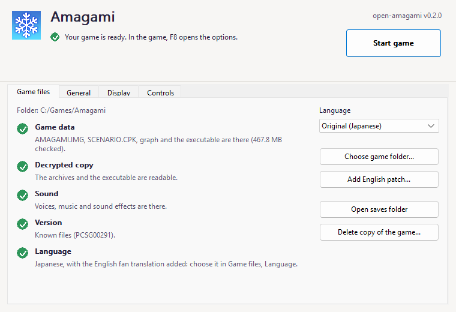
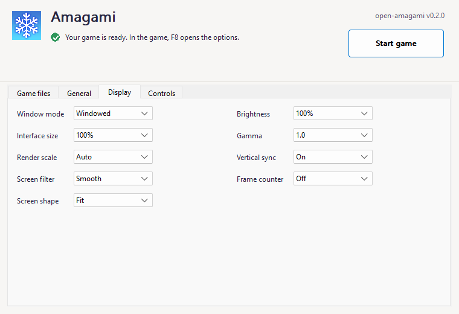
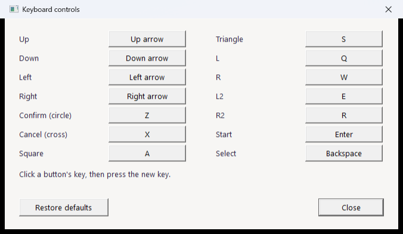

<p align="center">
  
</p>

<h1 align="center">open-amagami</h1>

<p align="center">
  Play <i>Amagami</i> (PS Vita) on your Windows PC, from your own copy of the game.<br>
  A free, non-profit fan project · <a href="https://hokagocafe.com">hokagocafe.com</a>
</p>

<p align="center">
  <a href="https://github.com/hokagocafe/open-amagami/releases/latest/download/open-amagami-windows-x86.zip"><b>⬇ Download for Windows</b></a>
  &nbsp;·&nbsp;
  <a href="https://github.com/hokagocafe/open-amagami/releases">All versions</a>
  &nbsp;·&nbsp;
  <a href="#how-to-play">How to play</a>
  &nbsp;·&nbsp;
  <a href="#questions">Questions</a>
</p>

<p align="center">
  
  
  
</p>
<p align="center"><sub>Screenshots of the program running with the English fan translation. More on <a href="https://hokagocafe.com">hokagocafe.com</a>.</sub></p>

---

**open-amagami** runs the PS Vita version of *Amagami ebKore+* natively on Windows: no emulator, sharp at any window size, with a
gamepad, the keyboard or the mouse. It is a new program that reads the game's own files from **your copy** of the game.

> **Nothing of the game is included here or in the download** (no pictures, sound, script or text). You need your own copy of the
> PS Vita game. This is an unofficial fan project, not affiliated with or endorsed by the game's makers or publishers; *Amagami* and
> everything in it belong to their owners.

## What you need

- A PC with **Windows 10 or 11**.
- **Your own copy of *Amagami ebKore+* for PS Vita** (`PCSG00291`) as a folder of files, the kind a PS Vita dump tool makes. It has
  to be the readable (decrypted) kind; the program checks it and tells you. It cannot make or fix one for you.

Nothing has to be installed: no runtimes, no emulator.

## How to play

**1. Download and unpack.** Get the zip with the [download link](https://github.com/hokagocafe/open-amagami/releases/latest/download/open-amagami-windows-x86.zip)
above, then right-click it, choose *Extract All...* and pick any folder (your Desktop is fine).

**2. Start `amagami.exe` and choose your game.** The launcher opens. Press **Choose game folder...**, pick the folder of your copy (the
one with `AMAGAMI.IMG` and `SCENARIO.CPK` inside, plus `eboot.bin` or `extracted/eboot_decrypted.elf`) and answer **Yes** to copy it
into the program's own folder. Each required check turns green when it is fine; the version check can be a warning for an unlisted
build:

<p align="center"></p>

**3. Press Start game.** That is all. The first time, the program also offers a shortcut on the desktop and in the Start menu;
next time, open it from there (or run `amagami.exe`) and press Start game. **Settings → Desktop shortcut** makes them again.

> Windows may say *"Windows protected your PC"* the first time, because the program is new and not signed. Press **More info**, then
> **Run anyway**.

## Playing in English

If your copy already has the English fan translation (*Amagami EbKore+ English v1.1*), the launcher says so and the game is in
English. If your copy is the original Japanese one and you have the translation's files, open **Settings**, press
**Add English patch...** and pick the translation's folder; the program copies what it needs and switches to English. You can switch
back in **Settings → Language** at any time.

## Controls

A gamepad (PlayStation, Xbox and most others) works as soon as it is plugged in, and the button pictures in the game follow the pad
you use. The mouse works in the menus. On the keyboard:

| Game button | Key | | Game button | Key |
|---|---|---|---|---|
| Confirm (circle) | Z | | Directions | Arrow keys |
| Cancel (cross) | X | | Start | Enter |
| Square / Triangle | A / S | | Select | Backspace |
| L / R | Q / W | | L2 / R2 | E / R |

Every key can be changed in **Settings → Controls...**. **F11** (or Alt+Enter) switches full screen, **Esc** quits.

<p align="center">
  
  
</p>

## Questions

**Where are my saves?** In `%APPDATA%\open-amagami` (paste that into the address bar of a folder window, or use **Settings → Open
saves folder**). Updating the program keeps them.

**How do I update?** When a new version is out, the launcher shows a **Get the new version** button that opens the download page
(the version you have is written beside the title; **Settings → Check for updates** turns the check off). Unpack the new zip over
the old folder, or into a new one: your saves, settings and copied game stay where they are, and the desktop and Start menu
shortcuts follow the new folder on their own.

**Can I delete my original copy after it is copied?** Yes. The program keeps its own copy in `%LOCALAPPDATA%\open-amagami`;
**Settings → Delete copy of the game...** removes it again.

**Can I keep everything in one folder (a USB stick)?** Put an empty file called `portable.txt` next to `amagami.exe`; saves, settings
and the game copy then go into a `portable-data` folder beside it.

**A check is red.** Read the line under it: it says what is missing or unreadable. The most common case is a copy that is still
encrypted; the program can only use a decrypted one. A prepared folder can use `extracted/eboot_decrypted.elf` instead of `eboot.bin`.

**Something looks or sounds wrong.** Please [open an issue](https://github.com/hokagocafe/open-amagami/issues) with what you did and
what you saw (a screenshot of the program helps). Never attach files of the game.

## Status

Early: these are the **v0.1** releases. The game's own scripts run unchanged, every scene of the story is run by automatic tests, the
drawing is compared with the console version scene by scene, and sound, saves, gamepads and the English translation work. Expect
rough edges, and tell us about them.

## For developers

The engine is C++ (32-bit, Windows), with SDL3 for gamepads and Direct3D 11 for drawing. You need Visual Studio's C++ tools (the
32-bit toolchain), CMake and Ninja:

```bat
call "...\VC\Auxiliary\Build\vcvarsall.bat" x86
cmake -S port -B build -G Ninja -DCMAKE_BUILD_TYPE=Release
cmake --build build
```

CMake downloads SDL3 (checked against a fixed SHA-256) the first time. The result is `build/amagami.exe`, with `skins/`, `script/`,
`art/` and `data/` copied beside it. Every release zip is built by the workflow in `.github/workflows` from the tagged source, and its
SHA-256 is published with it.

| Folder | What |
|---|---|
| `port/src` | the engine, the window, the launcher |
| `port/script` | our own classes that hook into the game's Settings screen (source and compiled) |
| `port/skins` | our button pictures |
| `port/art`, `port/data` | the splash picture and the program's icon; the table of known versions of the game's files |
| `tools/hokago` | the part of the shared tools needed to compile `port/script` |
| `docs` | notes on how the engine and its formats work |

Bug reports and ideas are welcome as issues; see [CONTRIBUTING.md](CONTRIBUTING.md).

## Licence

The code and our own art are under the [MIT licence](LICENSE). The libraries in `port/src/third_party` keep their own licences,
listed in [NOTICE.md](NOTICE.md).
